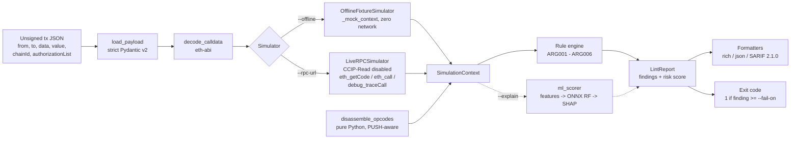

# ARGUS

**A pre-sign security linter for unsigned EVM transactions.**

`ARGUS` inspects a transaction *before* a wallet signs it and flags wallet drainers, permit
phishing, EIP-7702 delegation hijacks, dangerous bytecode and asymmetric asset drains. It runs
as a CLI, in CI (SARIF for GitHub code scanning) or from any IDE with `python3 -m argus`, and it
works fully offline against fixtures, with no RPC key.

## Why

Most drained wallets were not hacked. The owner signed something they could not read. Calldata is
opaque, permits are off-chain, and since EIP-7702 a single signature can hand an EOA's code
execution to an arbitrary contract. `argus` is a deterministic checkpoint between "build the
payload" and "sign it".

## Architecture



## Quickstart (any IDE, no PATH setup)

```bash
python3 -m venv .venv
source .venv/bin/activate            # Windows: .venv\Scripts\activate
pip install -e ".[dev]"              # core + pytest + ruff
pip install -e ".[ml]"               # optional: ONNX + SHAP explanations

python3 -m argus rules
python3 -m argus check examples/permit2_phishing.json --offline
python3 -m argus check examples/safe_uniswap_swap.json --offline
python3 -m argus check examples/proxy_delegatecall_drainer.json --offline --explain
```

Every command works identically as `argus ...` once installed. In an IDE, run
`python3 -m argus` as the module. Running `pytest` (or `python3 -m pytest`) executes the suite.

## Usage

```text
argus check <payload.json> [--rpc-url URL] [--offline] [--explain]
             [--format rich|json|sarif] [--fail-on low|medium|high|critical]
argus rules
```

| Exit code | Meaning                                                          |
|-----------|------------------------------------------------------------------|
| `0`       | No finding at or above `--fail-on` (default `high`)              |
| `1`       | At least one finding at or above `--fail-on`                     |
| `2`       | Operational error (bad payload, no backend selected, RPC error)  |

`--rpc-url` can also be supplied through the `ARGUS_RPC_URL` environment variable.

## Payload format

A flat JSON object with the unsigned-transaction fields. Quantities accept ints or `0x` hex.

```json
{
  "chainId": 1,
  "from": "0x...",
  "to": "0x...",
  "value": "0x0",
  "data": "0x...",
  "authorizationList": [{ "chainId": "0x0", "address": "0x...", "nonce": "0x1" }],
  "_mock_context": { "is_contract": true, "is_verified": false, "deployment_age_blocks": 37 }
}
```

`_mock_context` feeds the offline simulator: target metadata, per-address metadata, simulated
state diffs, and an optional `runtime_bytecode` that is disassembled by the pure-Python
disassembler.

## Rules

| ID       | Severity        | Detects                                                                 |
|----------|-----------------|-------------------------------------------------------------------------|
| `ARG001` | HIGH / CRITICAL | Unbounded `approve` (>= 2^255) or `setApprovalForAll(true)`; CRITICAL for EOA/unverified spender |
| `ARG002` | CRITICAL        | EIP-2612 `permit` to an EOA, or a deadline more than 30 days ahead      |
| `ARG003` | CRITICAL        | EIP-7702 delegation to an unverified/unknown contract (flags `chain_id = 0` replayability) |
| `ARG004` | HIGH            | Target deployed < 500 blocks ago and unverified                         |
| `ARG005` | HIGH            | Non-standard `DELEGATECALL` (no EIP-1967 slot) or `SELFDESTRUCT` in unverified bytecode |
| `ARG006` | CRITICAL        | Net outflow of ETH/ERC-20 with no inbound assets or receipt tokens      |

The deterministic risk score is the sum of severity weights (LOW 5, MEDIUM 15, HIGH 35,
CRITICAL 60), capped at 100.

## Sample output

<!-- Abridged illustration; replace with a real capture from your terminal. -->

```text
$ python3 -m argus check examples/permit2_phishing.json --offline
╭──────────────────────────── Decoded Call ─────────────────────────────╮
│ From      0x3c44cdddb6a900fa2b585dd299e03d12fa4293bc                    │
│ To        0xa0b86991c6218b36c1d19d4a2e9eb0ce3606eb48                    │
│ Function  permit                                                        │
│   spender 0xbadc0de0badc0de0badc0de0badc0de0badc0de0                    │
│   value   1157920892373161954235709850086879078532699846656405640394…   │
╰─────────────────────────────────────────────────────────────────────────╯
 Rule    Severity  Title                              Details / Remediation
 ARG002  CRITICAL  EIP-2612 permit phishing signature  Permit signature looks like phishing:
                                                       spender is an EOA; deadline is more
                                                       than 30 days ahead.
                                                       Fix: Do not sign. ...
╭─────────────────────────────── Verdict ────────────────────────────────╮
│                 DO NOT SIGN - deterministic risk score 60/100            │
╰─────────────────────────────────────────────────────────────────────────╯
$ echo $?
1
```

## Explainable AI scorer (`--explain`)

Rules are deterministic and auditable. `--explain` adds a second, independent opinion.

1. `extract_features` derives 8 behavioural features from the simulation (unbounded approval,
   untrusted spender, permit deadline horizon, untrusted 7702 delegate, unverified target,
   contract freshness, dangerous opcodes, asymmetric outflow). It never reads rule verdicts, so
   there is no label leakage.
2. A `RandomForestClassifier` trained on a **seeded synthetic dataset** (benign swaps vs. five
   drainer archetypes with stealth dropout) is exported to ONNX with `skl2onnx`.
3. `onnxruntime` scores a transaction on a single CPU thread (`scripts/train_model.py` prints the median latency; the test suite asserts < 5 ms).
4. `shap.TreeExplainer` attributes the probability to each feature; the CLI renders the bars.

The model is created automatically on first use. To train and inspect it explicitly:

```bash
python3 scripts/train_model.py        # prints hold-out metrics, ONNX parity, latency
```

> The training data is synthetic. The ML score demonstrates an explainability pipeline and should
> complement, never replace, the deterministic rules. Retrain on labelled real-world incidents
> before relying on it.

## GitHub code scanning (SARIF)

```yaml
- run: python3 -m argus check tx/payload.json --offline --format sarif > argus.sarif || true
- uses: github/codeql-action/upload-sarif@v3
  with: { sarif_file: argus.sarif }
```

## Testing

```bash
pytest -q
```

The suite covers every rule (`ARG001`-`ARG006`) including boundary conditions, PUSH-skipping
disassembly, EIP-1967 pairing, calldata decoding, SARIF structure, CLI exit codes, the CCIP-Read
hardening, and (when the `ml` extra is installed) the ONNX/SHAP pipeline.

## Security hardening

**Pre-sign isolation.** `ARGUS` is designed to sit *before* the signer:

- It never holds keys and never signs, broadcasts or sends transactions. The only RPC methods
  used are read-only: `eth_getBlockByNumber`, `eth_getCode`, `eth_call`, `debug_traceCall`.
- `--offline` performs zero network I/O, so payloads can be linted on an air-gapped machine.
- Payloads are untrusted input: parsed with strict Pydantic v2 models, addresses validated
  (checksum-checked when mixed-case), hex normalised, malformed calldata reported rather than
  trusted. No `eval`, no shelling out, no pickle: the ML model is ONNX, and the SHAP forest is
  retrained deterministically from a recorded seed instead of deserialising an artefact.
- Unknown or missing evidence fails safe: an unknown spender or delegate counts as unverified.
  Rules that need a trace (`ARG006`) stay silent and say so when no trace is available, rather
  than guessing.

**`OffchainLookup` / CCIP-Read SSRF (CVE-2026-40072).** EIP-3668 lets a contract revert with
`OffchainLookup(urls, ...)`, instructing the client to fetch attacker-chosen URLs. A linter that
simulates hostile contracts would otherwise make *your* host issue those requests (SSRF into
internal services or cloud metadata endpoints). `LiveRPCSimulator` therefore sets
`provider.global_ccip_read_enabled = False` at construction, asserts it, and also passes
`ccip_read_enabled=False` to every `eth_call`. A unit test pins this behaviour. The RPC URL
itself is restricted to absolute `http(s)` URLs.

## Limitations

- Source-code verification and contract age are not observable over plain RPC. In live mode a
  contract counts as verified only if listed in `ARGUS_VERIFIED_ADDRESSES`, and `ARG004` needs
  deployment age from an explorer or archive node (offline fixtures supply it).
- `debug_traceCall` is required for state diffs; many public RPC providers disable it.
- Decoding covers the selectors listed above; Permit2's own typed-data flows are out of scope.
- A clean report is not a guarantee of safety. `ARGUS` reduces risk; it is not an audit.

## License

MIT
